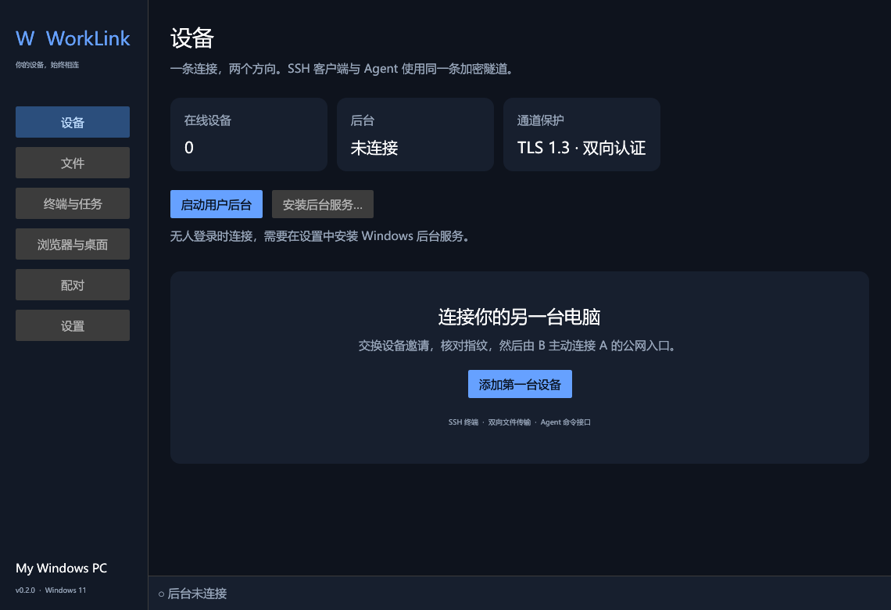

# WorkLink

Windows 11 上的个人远程工作台。以现有 SSH/SFTP 客户端为主，原生命令、ConPTY 终端和文件传输为兜底；同时支持远程浏览器、桌面 UI Automation 和 MCP。GUI、托盘、Agent CLI、用户会话助手和 Windows 服务使用同一个 EXE。



## 下载和启动

构建后的程序位于 `dist\WorkLink.exe`。双击打开中文工作台；关闭窗口后释放 GUI，原生托盘和后台可以继续运行。双击托盘重新打开界面。

程序面向 Windows 11 x64，以单个 EXE 分发，不依赖 .NET、WebView2 或另装 VC++ 运行库。SSH/SFTP 功能使用 Windows 已安装的 OpenSSH 客户端；原生兜底不依赖 SSH。

浏览器自动化使用已安装的 Edge/Chrome 与独立持久登录配置；桌面自动化使用 Windows 自带 PowerShell 和 .NET Framework 的 UI Automation，无需另外下载运行时。新能力默认关闭授权，详细使用、Token 预算、限制和 MCP 配置见 [浏览器、桌面与 MCP](docs/AUTOMATION.md)。

程序不自动安装服务、不改 SSH 配置、不开放防火墙，也不创建 frp 映射。Windows 服务安装和托盘自启由设置页或对应 CLI 命令启用。

默认数据目录：`%ProgramData%\WorkLink`。可以通过全局参数 `--data-dir` 指定其他目录。数据目录包含 DPAPI 保护的设备私钥、公开证书、配置、日志和任务记录；单 EXE 分发不等于运行时没有数据文件。

## 两台电脑首次配置

1. A、B 分别运行程序并创建身份，设备名称可直接使用 `A`、`B`。
2. A 保留默认监听 `127.0.0.1:41443`；B 可以勾选“只主动连接”。
3. 在“配对”页复制各自邀请和 SHA-256 指纹，通过你可信的方式交换。在另一台电脑粘贴邀请、核对并填写指纹。
4. B 添加 A 时填写 `你的公网主机:公网映射端口`。A 添加 B 时，公网入口留空。
5. 启动两端后台。两端均显示在线后，可以从任意方向操作对方。
6. 第一次使用 SSH，先打开 SSH 终端完成 OpenSSH 主机密钥确认和账户认证。之后 Agent 默认使用批处理认证，建议配置 SSH 公钥与 ssh-agent。

设备配对验证的是 WorkLink 身份；SSH 主机密钥和 Windows 登录账户仍由 OpenSSH 校验。SSH 认证失败不会自动切换原生兜底。

可以为每台设备保存本机使用的 SSH 用户和密钥路径，无需复制密钥内容：

```powershell
.\WorkLink.exe peer ssh A --user '目标用户名' --identity "$env:USERPROFILE\.ssh\id_ed25519"
# 如需独立主机信任文件，可同时指定 --known-hosts <本机文件路径>
```

密钥仍由系统 OpenSSH 读取；加密私钥建议交给 ssh-agent 解锁。`peer ssh A --clear` 清除这些本机客户端设置。

## frp 映射

在 A 的已有 `frpc.toml` 中添加以下代理，保留你自己的 frps 地址和认证配置：

```toml
[[proxies]]
name = "worklink"
type = "tcp"
localIP = "127.0.0.1"
localPort = 41443
remotePort = 41443
```

在公网服务器放行 **TCP 41443**。如果希望使用其他公网端口，只需修改 `remotePort`，并在 B 填写对应入口。A 本机监听端口可保持 41443。

使用 TCP 透传。frp 中转的是端到端 TLS 1.3 密文；无需让 A、B 之间直接访问 22。目标 OpenSSH Server 仍使用本机 `127.0.0.1:22`，不修改系统 SSH 端口。

无人登录时使用，需要确保 WorkLink、Windows OpenSSH Server 和 A 上的 frpc 都以相应后台方式启动。WorkLink 不接管你已有的 frp 服务。

## OpenSSH、WinSCP 和其他客户端

输出一段 SSH 配置，手动合并到 `%USERPROFILE%\.ssh\config`：

```powershell
.\WorkLink.exe ssh-config A --user '目标Windows用户名'
```

生成的 Host 使用稳定设备 ID。可以自行把 `Host` 别名改为 `worklink-a`，保留生成的 `HostName`、`HostKeyAlias` 和 `ProxyCommand`：

```powershell
ssh worklink-a
sftp worklink-a
scp .\app.zip worklink-a:C:/Temp/app.zip
```

对于使用本机端口的客户端，保持下面的转发命令运行：

```powershell
.\WorkLink.exe forward A --bind 127.0.0.1:22001
```

然后让 WinSCP、PuTTY 等连接 `127.0.0.1:22001`。使用目标 Windows 的用户名和 SSH 凭据；文件协议选择 SFTP。本机映射只允许绑定回环地址。

## Agent CLI

下面的命令无需添加 SSH 配置，直接使用设备记录。`--json` 是全局参数；实际错误和命令退出码会传回调用方。

```powershell
.\WorkLink.exe devices --json
.\WorkLink.exe exec A --user '目标用户名' --command 'Get-Process | Select-Object -First 5' --json
.\WorkLink.exe put A .\app.zip C:\Temp\app.zip --user '目标用户名' --json
.\WorkLink.exe get A C:\Temp\result.zip .\result.zip --user '目标用户名' --json
```

上传、下载先使用临时文件，完整 SHA-256 验证后提交。重新执行相同传输会尝试续传。目标文件存在时需要 `--overwrite`。

GUI/内置 CLI 当前按文件传输；整目录传输可以直接通过兼容的 WinSCP/SFTP 客户端进行。

原生兜底必须在**目标机器**给发起设备授权：

```powershell
# 在 A 上允许 B 访问 A 的原生命令和文件能力
.\WorkLink.exe peer allow B --exec true --files true

# 在 B 上执行 A 的持久任务
.\WorkLink.exe exec A --backend native --command 'Get-Date' --json
.\WorkLink.exe exec A --backend native --detach --command 'Start-Sleep 60; Get-Date' --json
.\WorkLink.exe job list A --json
.\WorkLink.exe job get A <返回的任务ID> --json
.\WorkLink.exe job cancel A <任务ID> --json
```

同一个 UUID 可通过 `exec --id <UUID>` 重复查询/提交相同任务，不会在任务记录保留期间重复执行。相同 UUID 对应不同命令时拒绝请求。后台重启后未完成任务标记为 `interrupted`，不自动重跑。保留最近约 200 个已结束任务；每个任务的 stdout、stderr 各最多保留 4 MiB。

普通原生任务使用配置所有者身份。服务模式下若该用户尚未登录，无法借用其用户令牌，会明确返回错误；SSH 仍可以使用自身认证建立用户会话。

## Windows 服务和管理员任务

先在稳定目录放好 EXE。使用**管理员 PowerShell**安装并启动后台服务：

```powershell
.\WorkLink.exe service install
.\WorkLink.exe service status --json
.\WorkLink.exe service stop
.\WorkLink.exe service start
.\WorkLink.exe service uninstall
```

服务使用自动启动，并配置异常退出恢复。已启动用户 daemon 时应先执行 `WorkLink.exe shutdown`，再安装/启动服务。同一数据目录只允许一个后台实例。

服务记录 EXE 的完整路径，安装后请保留程序所在位置。需要移动程序时先卸载服务，再从新位置安装。

安装前在目标机明确授权某设备的 SYSTEM 能力，之后请求仍必须显式指定 `--system`：

```powershell
# 在 A 上授权 B（也需要 --exec true 或 --files true）
.\WorkLink.exe peer allow B --system true

# 在 B 上调用 A；A 必须正在以 Windows 服务运行
.\WorkLink.exe exec A --backend native --system --command 'whoami' --json
```

SYSTEM 与个人管理员账户的环境、用户目录和网络访问身份不同。SSH 管理员权限则由 Windows OpenSSH 的账户和令牌策略决定。

## 安全和恢复范围

- 自定义消息协议使用 TLS 1.3 双向证书认证；连接两端严格匹配已配对证书，没有忽略证书验证选项。
- 邀请文件只有公开材料。设备私钥以 Windows DPAPI 机器范围保护，并通过目录 ACL 限制访问。
- 本地控制使用限制账户访问、拒绝远程客户端的 Windows 命名管道。
- 一条传输连接复用两个方向的 SSH、终端、任务和文件流；心跳和带抖动的退避机制负责重连。
- 自动重连不能复原已断开的 SSH 会话。长任务请使用原生持久任务或目标机自身的任务管理机制。
- 撤销设备后，后台会关闭其现有连接；新操作被拒绝。
- 撤销原生命令权限后，后台会取消该设备仍在执行的原生任务。
- 加密保护传输内容，不隐藏 IP、端口、流量时序，也不提供“无法被监控发现”的保证。

当前版本为个人工具的首个可运行版本；短时本机联调不能替代两台电脑上的公网与长时间运行验证。已完成和未完成的验证见 [docs/VALIDATION.md](docs/VALIDATION.md)。

## 从源码构建

需要 Rust stable MSVC 工具链和 Windows C++ 构建工具。

```powershell
git clone https://github.com/NatsumeMoMo/WorkLink.git
cd WorkLink
cargo fmt --check
cargo clippy --all-targets -- -D warnings
cargo test -- --nocapture
cargo build --release --locked
```

也可以运行 `scripts\build.ps1`，生成 `dist` 发布目录、文件 SHA-256 清单和 `releases` 下的 ZIP 包。GitHub Actions 会在 Windows 上执行同一构建脚本，并上传构建包。端到端测试使用独立目录和回环端口，不改机器现有 SSH/frp/防火墙配置。

详细 Agent 约定见 [docs/AGENT_API.md](docs/AGENT_API.md)，协议和权限说明见 [docs/IMPLEMENTATION.md](docs/IMPLEMENTATION.md)，实际界面见 [docs/worklink-ui.png](docs/worklink-ui.png)。
